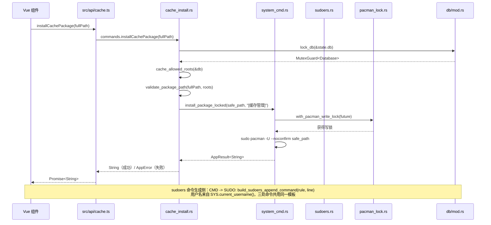
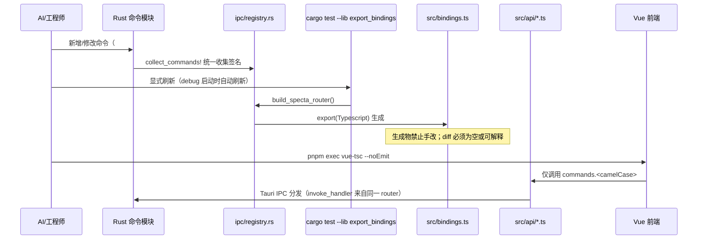
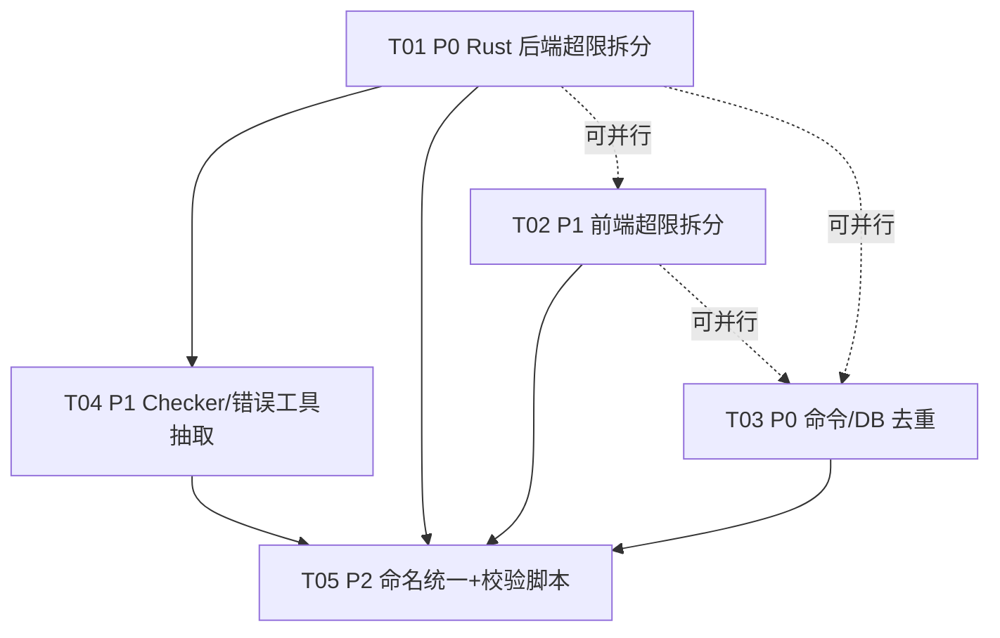

# My-AUR-Helper 工程治理重构设计（系统设计 + 任务分解）

> 版本：2026-11-25 ｜ 架构师：Bob（高见远）
> 上游输入：`AGENTS.md`（规范）、`CODE_QUALITY_ISSUES.md`（问题清单，24 项待修复）
> 范围：仅针对问题清单中**需要代码修改**的部分做设计，不含实现代码；代码落地由下一阶段工程师执行
> 说明：本文件原内容为 UI 改进方案（视图切换 / 图标 / 设置页 / 日志防抖 / 启动并行化），与本次治理主题不同，本次重写为治理专项设计；旧方案如仍需实施请另行排期

---

# Part A：系统设计

## 1. Implementation Approach（实现思路）

### 1.1 核心矛盾

仓库 `src/` + `src-tauri/src/` 共 43,289 行，由多个 AI 智能体协作修改。当前三个痛点：

1. **规范不可机械校验**：原 AGENTS.md 有「300 行」原则但无例外清单、无校验命令、无统一命名表 → 已在本次交付物 A 补齐
2. **5 个真实超限文件**：最大 348 行，且 `get_packages_from_archive` 单函数 148 行、`sync_from_aur` 单命令 198 行
3. **重复逻辑散布**：`whoami` ×3、sudoers 命令字符串 ×3、`pacman` 安装/查询 ×2×2、DB 锁错误模板 ×32、CheckResult 构造 ×7、前端错误三件套 ×3、HTTP client ×8、GitHub URL ×14

### 1.2 总体策略

按 **「结构拆分 → 逻辑去重 → 命名收敛」** 三段推进，先解构大文件腾出空间，再抽取公共方法，最后统一命名并落地校验脚本。

| 阶段 | 目标 | 对应任务 |
|------|------|----------|
| 结构拆分 | 5 个超限文件降到 ≤300 行，保持对外 API 与 bindings 不变 | T01 / T02 |
| 逻辑去重 | 14 项重复收敛到明确公共落点，安全相关重复优先 | T03 / T04 |
| 命名收敛 | 命名不一致消除，300 行校验脚本化，防止复发 | T05 |

### 1.3 关键技术取舍

1. **`lib.rs` 的 `collect_commands!` 必须整体搬迁、不可拆散**
   - 它是 88 个命令的唯一注册点，也是 bindings 的单一来源。拆分时整块移到 `ipc/registry.rs`，验收标准是 `cargo test --lib export_bindings` 生成的 `src/bindings.ts` 与基线 diff 为空。
2. **公共方法落点优先复用现有模块，避免制造新抽象层**
   - 已有 `http_client.rs`（`shared_client` / `build_client`）、`useToast.ts`（`addToast`）、`backup_install_helpers.rs`（路径/sudoers 辅助）。
   - 但 `backup_install_helpers.rs` 已 286 行（临界预警），**新能力不得再塞入**，改为新建 `sysops/sudoers.rs`、`sysops/system_cmd.rs`。
3. **拆分保持调用方零改动**
   - `checkers/utils.rs` 降为 barrel（仅 `mod` + `pub use`），子模块承担实现；`checkers/mod.rs` 的 `pub use utils::*` 继续有效。
   - `software_sync/aur.rs` 拆为 `aur/` 子模块后，`commands::sysops::software_sync::aur::sync_from_aur` 注册路径不变，`lib.rs` 无需改。
4. **`PackageList.vue` 只超 3 行，但不做删注释式达标**
   - 抽出 `#filters`（57 行）与批量按钮（25 行）为两个组件，降至约 245 行，为后续迭代留出余量；特别保持 AGENTS.md 规定的 `selection-change` 选中同步链路不破坏。
5. **前端错误处理三件套一次性收敛**
   - `formatErrorMessage` / `isNetworkError` / `showError` 三处逐字相同，统一到 `src/utils/errors.ts` + `useToast.ts::showActionError`，UI 表现不变。
6. **不新增第三方依赖**：治理专项只重排代码与补脚本，全部使用项目已有工具链。

---

## 2. File List（受影响文件清单）

### 2.1 新增文件（19 个）

| 文件 | 职责 |
|------|------|
| `src-tauri/src/aur/metadata/cache.rs` | 归档缓存结构、读写、ETag 校验器 |
| `src-tauri/src/aur/metadata/download.rs` | 归档下载客户端与带重试下载 |
| `src-tauri/src/aur/metadata/tests.rs` | 元数据相关单测 |
| `src-tauri/src/commands/sysops/software_sync/aur/config.rs` | 同步设置读取聚合 |
| `src-tauri/src/commands/sysops/software_sync/aur/collect.rs` | AUR 结果映射、缺包分类 |
| `src-tauri/src/commands/sysops/software_sync/aur/persist.rs` | 批量写库与失败标记 |
| `src-tauri/src/commands/sysops/software_sync/aur/update.rs` | `update_aur_info` 命令 |
| `src-tauri/src/checkers/utils/regex.rs` | 静态正则与正则版本提取 |
| `src-tauri/src/checkers/utils/url.rs` | owner/repo 与 URL/HTML 版本提取 |
| `src-tauri/src/checkers/utils/version.rs` | 版本清洗与归一化 |
| `src-tauri/src/ipc/registry.rs` | `build_specta_router` + `export_bindings`（整体迁入） |
| `src-tauri/src/app_state.rs` | `AppState` / `CloseAction` / 配置读取 |
| `src-tauri/src/app_setup.rs` | 数据库 / 日志 / 托盘 / 缓存初始化 |
| `src-tauri/src/app_events.rs` | 窗口关闭与退出写盘事件 |
| `src-tauri/src/commands/sysops/system_cmd.rs` | `whoami` / `pacman -Qip` / `sudo pacman -U` / `gsettings` 公共方法 |
| `src-tauri/src/commands/sysops/sudoers.rs` | sudoers 探测、规则构造、追加命令生成 |
| `src-tauri/src/checkers/helpers.rs` | `finish_check` / `log_check_result` |
| `src-tauri/src/checkers/github/api_urls.rs` | GitHub REST / GraphQL URL 常量与构造函数 |
| `src/utils/errors.ts` | `isNetworkError` / `formatErrorMessage` / 关键词表 |
| `src/components/package/PackageListFilterToolbar.vue` | 条件筛选 + 快捷筛选 + 视图切换区块 |
| `src/components/package/PackageBatchToolbar.vue` | 8 个批量操作按钮 |
| `scripts/check-file-lines.sh` | 300 行硬上限机械校验脚本 |

### 2.2 修改文件

| 文件 | 改动摘要 |
|------|----------|
| `src-tauri/src/aur/metadata.rs` | 保留编排 + 降级调度，降为 barrel 式主文件 |
| `src-tauri/src/commands/sysops/software_sync/aur.rs` | 仅保留 `sync_from_aur` 编排骨架 + 子模块声明 |
| `src-tauri/src/checkers/utils.rs` | 改为 barrel re-export |
| `src-tauri/src/lib.rs` | 保留模块声明 + `run()` 骨架（约 90 行） |
| `src/views/PackageList.vue` | 模板拆分、保留数据流与选中同步 |
| `src/views/PackageList.css` | 接收从小组件迁出的样式（如需要） |
| `src-tauri/src/commands/sysops/backup_install.rs` | 改用公共方法 + 子模块 re-export |
| `src-tauri/src/commands/sysops/cache_install.rs` | 改用公共方法 |
| `src-tauri/src/commands/sysops/cache_cleanup.rs` | 改用公共方法 |
| `src-tauri/src/commands/sysops/backup_install_helpers.rs` | sudoers 相关函数迁出到 `sudoers.rs` 并 re-export |
| `src-tauri/src/db/mod.rs` | 新增 `lock_db()` |
| `src-tauri/src/errors.rs` | 新增 `From<PoisonError<T>> for AppError` |
| `src-tauri/src/http_client.rs` | 提供可覆盖参数的 `build_client` 用法（不改公共 API） |
| `src-tauri/src/checkers/github/*.rs`（6 个）+ `db/github_tag_cache_extend.rs` | URL 改调 `api_urls.rs` |
| `src-tauri/src/commands/sysops/software_sync/{batch_helpers,cache,upstream,batch,batch_engine}.rs` + `software_check/selected.rs` | 统一 `UpstreamCheckResult` builder |
| `src-tauri/src/checkers/{http,gitee,gitlab,redirect,browser}.rs` + `github/tags_checker.rs` | 统一 `finish_check` / `log_check_result` |
| `src/composables/{packageCheckActions,packageSyncActions,packageDeleteActions}.ts` | 删除本地三件套，import 公共实现 |
| `src/composables/useToast.ts` | 新增 `showActionError` |
| `src/api/software.ts` | 消除 `as unknown as`（能对齐部分） |
| `src/utils/format.ts` | `fmtTimestamp` → `formatDateOnly` + 兼容别名 |
| `src/composables/packageActions.ts` 等 4 文件 | `git mv` 重命名为 `useXxx.ts` |
| `AGENTS.md` / `CODE_QUALITY_ISSUES.md` | T05 完成后更新进度与规范 |

---

## 3. Data Structures and Interfaces（类图 / 接口定义）

### 3.1 类图

```mermaid
classDiagram
    class SystemCommandOps {
        <<module: sysops/system_cmd.rs>>
        +current_username() AppResultString
        +pacman_package_info(path) AppResultString
        +install_package_locked(path, tag) AppResultString
        +gsettings_get(schema, key) AppResultString
    }
    class SudoersOps {
        <<module: sysops/sudoers.rs>>
        +sudo_privileges_text() OptionString
        +has_nopasswd_rule(text, rule) bool
        +is_rule_effective(rule) AppResultBool
        +build_pacman_install_rules(dir) String
        +build_sudoers_append_command(rule, line) String
    }
    class DbLockHelper {
        <<module: db/mod.rs>>
        +lock_db(db) AppResultGuard
    }
    class AppErrorBridge {
        <<module: errors.rs>>
        +FromPoisonError() AppError
    }
    class CheckResultHelpers {
        <<module: checkers/helpers.rs>>
        +finish_check(version, license, langs) CheckResult
        +log_check_result(pkgname, version) void
    }
    class UpstreamResultBuilder {
        <<module: software_sync/batch_helpers.rs>>
        +build_upstream_result(entry) UpstreamCheckResult
    }
    class GithubApiUrls {
        <<module: checkers/github/api_urls.rs>>
        +GH_API_BASE String
        +repo_url(owner, repo) String
        +tags_url(owner, repo) String
        +releases_latest_url(owner, repo) String
        +graphql_url() String
    }
    class HttpClient {
        <<existing module>>
        +shared_client() Client
        +build_client(config) Client
        +get_client_for_domain(domain, config) Client
    }
    class ErrorUtils {
        <<module: utils/errors.ts>>
        +NETWORK_ERROR_KEYWORDS string[]
        +isNetworkError(e) boolean
        +formatErrorMessage(e, context) string
    }
    class ToastFeedback {
        <<module: composables/useToast.ts>>
        +addToast(level, text) number
        +showActionError(footer, e, context) void
    }
    class IpcRegistry {
        <<module: ipc/registry.rs>>
        +build_specta_router() Builder
        +export_bindings() void
    }

    BackupInstall ..> SudoersOps : uses
    BackupInstall ..> SystemCommandOps : uses
    CacheInstall ..> SudoersOps : uses
    CacheInstall ..> SystemCommandOps : uses
    CacheCleanup ..> SudoersOps : uses
    BackupInstall ..> DbLockHelper : uses
    CacheInstall ..> DbLockHelper : uses
    DbLockHelper ..> AppErrorBridge : maps
    SystemCommandOps ..> HttpClient : optional
    GithubApiUrls <.. CheckersGithub : calls
    CheckersGithub ..> CheckResultHelpers : uses
    SyncBatch ..> UpstreamResultBuilder : uses
    PackageActions ..> ErrorUtils : uses
    PackageActions ..> ToastFeedback : uses
    IpcRegistry ..> CheckersGithub : collects 88 commands
```



### 3.2 公共方法接口契约

**Rust（签名约定，`AppResult<T> = Result<T, AppError>`）**

```rust
// sysops/system_cmd.rs
pub(crate) async fn current_username() -> AppResult<String>;
pub(crate) async fn pacman_package_info(path: &std::path::Path) -> AppResult<String>;
pub(crate) async fn install_package_locked(
    safe_path: &std::path::Path, module_tag: &str
) -> AppResult<String>;
pub(crate) fn gsettings_get(schema: &str, key: &str) -> AppResult<String>;

// sysops/sudoers.rs
pub(crate) async fn sudo_privileges_text() -> Option<String>;
pub(crate) fn has_nopasswd_rule(text: &str, rule: &str) -> bool;
pub(crate) async fn is_rule_effective(rule: &str) -> AppResult<bool>;
pub(crate) fn build_pacman_install_rules(dir: &str) -> String;
pub(crate) fn build_sudoers_append_command(rule: &str, line: &str) -> String;

// db/mod.rs
pub fn lock_db(db: &Mutex<Database>) -> AppResult<MutexGuard<'_, Database>>;

// checkers/helpers.rs
pub(crate) fn finish_check(
    version: Option<String>, license: Option<String>, language_names: Vec<String>
) -> CheckResult;
pub(crate) fn log_check_result(pkgname: &str, version: &Option<String>);

// checkers/github/api_urls.rs
pub(crate) const GH_API_BASE: &str = "https://api.github.com";
pub(crate) fn repo_url(owner: &str, repo: &str) -> String;
pub(crate) fn tags_url(owner: &str, repo: &str) -> String;
pub(crate) fn graphql_url() -> String;
```

**TypeScript**

```typescript
// src/utils/errors.ts
export const NETWORK_ERROR_KEYWORDS: readonly string[];
export function isNetworkError(e: unknown): boolean;
export function formatErrorMessage(e: unknown, context: string): string;

// src/composables/useToast.ts（新增导出）
export function showActionError(footer: FooterState, e: unknown, context: string): void;
```

---

## 4. Program Call Flow（时序图）

### 4.1 重构后「安装缓存包」调用链（M-001/002/004 + M-006 收敛效果）



### 4.2 IPC 注册与 bindings 生成（铁律闭环）



---

## 5. Anything UNCLEAR（不明确处与假设）

1. **测试文件豁免 300 行**：本次设计按「独立 `tests.rs` / `*.test.ts` 豁免」处理，需 team-lead / 用户最终确认；若不豁免，则 `metadata/tests.rs` 等也需要再拆。
2. **bindings 基线**：以当前 `src/bindings.ts`（1340 行）为逐字节基线。T01 搬迁 `collect_commands!` 后必须 diff 为空；若因命令顺序变化产生 diff，需在 PR 中逐条说明，不得直接接受。
3. **4 个 composable 重命名的影响面**：假设全仓引用均可通过 `rg` 检索到（前端无动态 import / 字符串路径引用）。T05 执行前需再跑一次 `rg -n 'packageActions|packageCheckActions|packageDeleteActions|packageSyncActions' src` 复核。
4. **本设计为静态审计产物**：本阶段未执行 `cargo check` / `cargo clippy` / `vue-tsc`（只读审计原则）；所有编译期结论需在工程师阶段验证。环境铁律：跑 cargo 前须 `export HOME=/home/zxp-archlinux CARGO_HOME=<repo>/.cargo RUSTUP_HOME=<repo>/.rustup`，Bash 需关 sandbox。
5. **旧 `system_design.md` 内容**：原 UI 改进方案（视图切换 / 列配置 / 图标语义 / 设置页元数据 / 日志防抖 / 启动并行化）未纳入本次治理，也未确认是否已实施；如仍需推进需单独排期。

---

# Part B：Task Decomposition

## 6. Required Packages（依赖）

**无新增第三方依赖**。治理专项仅做文件重排、函数抽取与脚本补充，复用现有工具链：

| 工具 | 用途 | 来源 |
|------|------|------|
| `cargo fmt` / `cargo clippy` / `cargo test` | Rust 格式 / lint / 单测 / bindings 导出 | Rust 工具链（`.cargo` / `.rustup` 已就位） |
| `vue-tsc` / `pnpm build` | 前端类型检查 / 构建 | `package.json` 现有 devDependencies |
| `rg` (ripgrep) | 重复检索、import 复核 | 系统工具 |
| `wc -l` / `find` / `xargs` | 300 行硬上限校验 | POSIX 工具 |

---

## 7. Task List（按依赖排序，5 个任务）

> **执行状态（T05 收尾回填）**：T01~T05 **全部已完成**，源码改动已收口，交付 QA 独立全量回归。
> 下方逐任务表格保留原始验收标准与风险提示；最终证据见 `CODE_QUALITY_ISSUES.md` 第六/七/八节，
> **保留项/迁移计划如实留痕，未虚报为全部清零**。

| 任务 | 状态 | 核心结果 | 保留项 |
|------|------|----------|--------|
| T01 | ✅ 已完成 | 4 个 Rust 超限文件拆分（348/341/339/335 → 135/92/26/104 行），对外路径不变，bindings diff 为空 | 仅 1 项真存量 clippy 告警 `trait_def.rs:33`（`-A` 放行）；`fe_log.rs:1` 经 QA 证实为本轮新引入、已修复，见 `CODE_QUALITY_ISSUES.md` 第九节 |
| T02 | ✅ 已完成 | `PackageList.vue` 303 → 247 行，抽 2 个纯 props/emits 组件，`selection-change` 链路逐字保留 | — |
| T03 | ✅ 已完成 | 系统命令 / sudoers / DB 锁 / GitHub URL / gsettings 收敛；`whoami` 与 `api.github.com` 收敛到唯一落点 | M-006 剩余 23 处 `map_err` + 61 处直连；M-012 8 处 HTTP client 因特殊策略保留 |
| T04 | ✅ 已完成 | `finish_check` 收敛 7 处 CheckResult + 日志；前端错误三件套收敛到 `errors.ts` / `useToast.ts` | M-008 9 处 `UpstreamCheckResult`；`api_checker.rs` 多分支日志 |
| T05 | ✅ 已完成 | 4 个 composable `git mv` 改名、新增测试补 `test_` 前缀、300 行校验脚本、全仓 `cargo fmt --all`、两本文档回填 | 存量描述式测试命名、`format.ts` 命名歧义、两个 Card 本地 `fmtTimestamp`、`as unknown as` |

### T01：Rust 后端超限文件拆分

| 项 | 内容 |
|----|------|
| **Task ID** | T01 |
| **任务名** | Rust 后端四个超限文件结构拆分（H-001 ~ H-004） |
| **源文件** | `src-tauri/src/aur/metadata.rs`、`aur/metadata/cache.rs`(新)、`aur/metadata/download.rs`(新)、`aur/metadata/tests.rs`(新)、`src-tauri/src/commands/sysops/software_sync/aur.rs`、`software_sync/aur/config.rs`(新)、`aur/collect.rs`(新)、`aur/persist.rs`(新)、`aur/update.rs`(新)、`src-tauri/src/checkers/utils.rs`、`checkers/utils/regex.rs`(新)、`utils/url.rs`(新)、`utils/version.rs`(新)、`src-tauri/src/lib.rs`、`src-tauri/src/ipc/registry.rs`(新)、`src-tauri/src/app_state.rs`(新)、`src-tauri/src/app_setup.rs`(新)、`src-tauri/src/app_events.rs`(新) |
| **依赖** | 无（规范已在 AGENTS.md 定稿） |
| **优先级** | **P0** |
| **验收标准** | ① 4 个 Rust 文件均 ≤300 行；② `cargo test --lib export_bindings` 生成的 `bindings.ts` 与基线 diff 为空；③ `cargo clippy --all-targets -- -D warnings` 通过；④ `commands::sysops::software_sync::aur::*` 与 `checkers::utils::*` 对外路径不变 |
| **风险提示** | `collect_commands!` 88 条必须整体搬迁、一条不漏；拆 `run()` 时保持 `setup` 闭包内初始化顺序（DB → 日志 → 托盘 → 图标 → 缓存） |

### T02：前端超限文件拆分

| 项 | 内容 |
|----|------|
| **Task ID** | T02 |
| **任务名** | `PackageList.vue` 模板区块组件化（H-005） |
| **源文件** | `src/views/PackageList.vue`、`src/components/package/PackageListFilterToolbar.vue`(新)、`src/components/package/PackageBatchToolbar.vue`(新)、`src/views/PackageList.css` |
| **依赖** | 无（可与 T01 并行） |
| **优先级** | **P1** |
| **验收标准** | ① `PackageList.vue` ≤300 行；② `vue-tsc --noEmit` 与 `pnpm build` 通过；③ 手动验证：筛选条件生效、视图切换生效、选中 N 个后批量操作只作用于选中项（AGENTS.md 的 `selection-change` 同步链路不破坏） |
| **风险提示** | 抽组件时 props/emits 类型必须显式声明，不得用 `any` 逃逸 |

### T03：Rust 系统命令 / sudoers / DB 锁 / URL 重复抽取

| 项 | 内容 |
|----|------|
| **Task ID** | T03 |
| **任务名** | 重复命令与重复错误处理公共化（M-001~M-006、M-012~M-014） |
| **源文件** | `src-tauri/src/commands/sysops/system_cmd.rs`(新)、`sysops/sudoers.rs`(新)、`sysops/backup_install.rs`、`sysops/cache_install.rs`、`sysops/cache_cleanup.rs`、`sysops/backup_install_helpers.rs`、`sysops/proxy_utils.rs`、`src-tauri/src/db/mod.rs`、`src-tauri/src/errors.rs`、`src-tauri/src/http_client.rs`、`src-tauri/src/checkers/github/api_urls.rs`(新)、`checkers/github/release_history.rs`、`release.rs`、`graphql_batch_query.rs`、`tags.rs`、`repo_info.rs`、`graphql_batch_tags.rs`、`git_describe.rs`、`release_tags.rs`、`src-tauri/src/db/github_tag_cache_extend.rs` |
| **依赖** | 无（与 T01 文件不重叠，可并行） |
| **优先级** | **P0** |
| **验收标准** | ① `rg -n 'Command::new\("whoami"\)' src-tauri/src` 仅命中 `system_cmd.rs` 1 处；② 三处 sudoers 追加命令模板合并为 1 个函数且有单测；③ DB 锁 32 处改用 `lock_db(&state.db)?`（或已标注迁移计划），`From<PoisonError>` 生效；④ `api.github.com` 硬编码仅存在于 `api_urls.rs`；⑤ 全部相关文件 ≤300 行 |
| **风险提示** | 提权命令字符串必须**逐 token** 与 sudoers 规则一致（现有单测 `cleanup_args_match_sudoers_rule` 保留并扩展）；禁止改变 `-n` 选项位置 |

### T04：Checker 结果构造与前端错误工具抽取

| 项 | 内容 |
|----|------|
| **Task ID** | T04 |
| **任务名** | 重复构造与前端错误处理三件套收敛（M-007~M-011） |
| **源文件** | `src-tauri/src/checkers/helpers.rs`(新)、`checkers/http.rs`、`gitee.rs`、`gitlab.rs`、`redirect.rs`、`browser.rs`、`github/tags_checker.rs`、`src-tauri/src/commands/sysops/software_sync/batch_helpers.rs`、`software_sync/cache.rs`、`upstream.rs`、`batch.rs`、`batch_engine.rs`、`software_check/selected.rs`、`src/utils/errors.ts`(新)、`src/composables/packageCheckActions.ts`、`packageSyncActions.ts`、`packageDeleteActions.ts`、`src/composables/useToast.ts` |
| **依赖** | T01（`checkers/utils.rs` 拆分后路径稳定，避免同时改同一模块） |
| **优先级** | **P1** |
| **验收标准** | ① `rg -n 'formatErrorMessage|isNetworkError' src/composables` 仅剩 import，无本地定义；② 7 处 CheckResult 构造统一调用 `finish_check` / `log_check_result`；③ 6 处 `UpstreamCheckResult` 统一调用 builder；④ 前端错误提示文案与重构前一致；⑤ clippy / vue-tsc 通过 |
| **风险提示** | `tags_checker.rs` 的 `language_names` 需显式传参，不得被 `Default` 吞掉 |

### T05：命名统一与规范落地校验

| 项 | 内容 |
|----|------|
| **Task ID** | T05 |
| **任务名** | 命名风格统一 + 300 行校验脚本化（L-001~L-003、L-005） |
| **源文件** | `src/composables/packageActions.ts` → `usePackageActions.ts`、`packageCheckActions.ts` → `usePackageCheckActions.ts`、`packageDeleteActions.ts` → `usePackageDeleteActions.ts`、`packageSyncActions.ts` → `usePackageSyncActions.ts`（均 `git mv`）、`src/utils/format.ts`、`src/api/software.ts`、`src-tauri/src/commands/sysops/backup_install.rs`、`cache_cleanup.rs`、`scripts/check-file-lines.sh`(新)、`AGENTS.md`、`CODE_QUALITY_ISSUES.md` |
| **依赖** | T01、T02、T03、T04（避免与前面任务同时改同一文件；改名后需全仓 import 复核） |
| **优先级** | **P2** |
| **验收标准** | ① `bash scripts/check-file-lines.sh` 输出仅 `bindings.ts`（已标注豁免）；② 4 个 composable 文件名 = 导出名 = `useXxx`；③ 新增测试函数均 `test_` 前缀；④ `as unknown as` 存量 ≤ 已说明理由的例外；⑤ 全量校验命令通过；⑥ 两本文档的进度表更新为已完成 |
| **风险提示** | 重命名前必须 `rg -n 'packageActions\|packageCheckActions\|packageDeleteActions\|packageSyncActions' src` 复核引用，禁止遗漏动态引用 |

---

## 8. Shared Knowledge（跨文件约定）

1. **命名**：严格遵循 `AGENTS.md`「统一命名规范表」。Rust 函数/变量 `snake_case`、类型 `PascalCase`、常量 `UPPER_SNAKE_CASE`、测试 `test_*`；TS 变量函数 `camelCase`、类型组件 `PascalCase`、composable 文件名 = 导出名 = `useXxx`。
2. **行数**：源文件硬上限 300 行（`wc -l` 含注释空行）；例外仅生成物（由规范登记，禁手改）/ 纯数据表 / 测试文件（后两类须头注释标注 `@LINE_LIMIT_EXEMPT`）。>270 行禁止再新增逻辑。
3. **公共方法落点**：
   - 系统命令 → `commands/sysops/system_cmd.rs`
   - sudoers / 提权 → `commands/sysops/sudoers.rs`（从已满的 `backup_install_helpers.rs` 迁出）
   - DB 锁 / 错误映射 → `db/mod.rs`、`errors.rs`
   - Checker 结果 → `checkers/helpers.rs`
   - HTTP client → `http_client.rs`（禁止另起 `Client::builder()`）
   - GitHub URL → `checkers/github/api_urls.rs`
   - 前端错误 → `utils/errors.ts` + `composables/useToast.ts`
4. **IPC 铁律**：命令必须 `#[tauri::command]` + `#[specta::specta]` 双宏；唯一注册点 `collect_commands!`；改签名后必须 `cargo test --lib export_bindings` 重新生成 `src/bindings.ts`，生成物禁手改；前端仅走 `src/api/*.ts` 的 `commands.*`，`invoke(` 保持 0 处。
5. **拆分兼容**：对外 `pub use` / barrel 路径保持不变，调用方零改动；`bindings.ts` diff 为空是 T01 的硬验收。
6. **安全不回退**：提权命令 `-n` 位置、路径校验白名单、sudoers 规则逐 token 一致性、异步上下文禁用 `reqwest::blocking` 均不得因重构改变。
7. **AI 协同**：改代码前读 AGENTS.md 与问题清单；提交前跑 `cargo fmt --check` / `cargo clippy -D warnings` / `cargo test --lib` / `vue-tsc` / `pnpm build` / 行数校验；cargo 前导出 `HOME`/`CARGO_HOME`/`RUSTUP_HOME` 且 Bash 关 sandbox；`Grep` 工具在本仓常 exit 104，统一用 `Bash + rg --glob '!**/target/**'`。
8. **不扩大范围**：只改任务指定文件；范围外问题写入 `CODE_QUALITY_ISSUES.md`，不顺手改。

---

## 9. Task Dependency Graph（任务依赖图）



**并行建议**：T01、T02、T03 三组文件不重叠，可由三名工程师并行；T04 等 T01 完成；T05 收尾统一验收。
